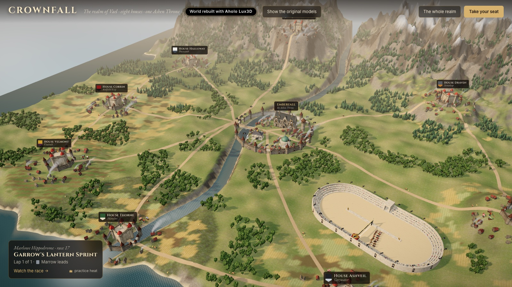

# Crownfall, rebuilt with Aholo Lux3D

A playable 3D medieval realm in the browser. Every castle, wall, tower, house and hall in it is placed from six 3D models, and all six were generated from text with the [Aholo Lux3D](https://3d.aholo.ai/) API.

Entry for the **Manycore Aholo Global 3D AI Hackathon** (November 2026).

- **Play it:** https://crownfall-lux3d.vercel.app (no sign-in, runs in the browser)
- **Prompts and task numbers:** https://crownfall-lux3d.vercel.app/lux3d/index.html
- **Project report (PDF):** [report/report.pdf](report/report.pdf)



## Try it in two minutes

| Do this | You see |
|---|---|
| Open the demo | The whole realm: eight castles, a walled capital, villages, a hippodrome with a race running |
| Click **Take your seat**, pick a lord and a house | You are on foot in a Lux3D town. W A S D to walk, your chariot is next to you |
| Click **World rebuilt with Aholo Lux3D** | Each model's exact prompt, its Lux3D task number, and a picture of the model |

## The idea

Crownfall's layout is code. It decides where every wall segment, tower and house goes and stretches one model into each slot, so the built world is defined by six models. That makes the look of the whole realm six sentences of text: change the sentences, run Lux3D, and hundreds of buildings change without touching the layout or the game.

## What Lux3D does here

| Kit model | Used for |
|---|---|
| `keep` | the castle keep at the heart of each of the eight houses |
| `tower` | every wall tower and gatehouse tower |
| `wall` | every stretch of castle and city wall |
| `cottage` | the village cottages |
| `townhouse` | the town and capital houses |
| `throne-hall` | the great hall of the Ashen Throne in the capital |
| `props/barrel`, `props/crate` | the barrels and crates in the markets and halls, including the ones that tumble when a chariot hits them |
| `props/well`, `props/hay` | the village wells and the hay bales |

Each one is a single Lux3D text-to-3D task, with no reference image and no manual modelling. The prompts are in [tools/lux3d/kit.json](tools/lux3d/kit.json). The task numbers, generation times and triangle counts are written by the script as it runs into [web/public/lux3d/kit.json](web/public/lux3d/kit.json).

## How it works

| Step | Where |
|---|---|
| Create a Lux3D task (`POST /lux3d/v1/generate/text-to-3d/task/create`), waiting for the one-at-a-time slot | `createTask` in [tools/lux3d/kit.mjs](tools/lux3d/kit.mjs) |
| Poll it (`GET /lux3d/v1/generate/task/get`) and download the GLB | `waitForTask`, `download` in the same file |
| Fit the model for the realm: one mesh, base colour only, common size, simplified, WebP texture, meshopt compression | `fit` in the same file |
| Load each model from the Lux3D set | [web/src/realm/kit.ts](web/src/realm/kit.ts) |
| Draw each model as one instanced mesh, stretched into every slot | [web/src/realm/Props.tsx](web/src/realm/Props.tsx) |
| Decide where the slots are | [web/src/realm/Buildings.tsx](web/src/realm/Buildings.tsx) |

## Run it yourself

```bash
cd web && npm install && npm run dev
```

To regenerate the kit you need an Aholo API key from https://labs.aholo.ai/api-keys:

```bash
cd tools/lux3d && npm install
echo "AHOLO_API_KEY=your-key" > .env
node kit.mjs            # generate whatever is missing
node kit.mjs keep wall  # generate these again
node kit.mjs --fit keep # re-run only the fitting step
```

## What Lux3D made, and what we made for this event

- **Lux3D:** the six kit models above, which are every building in the realm. The market barrels, crates, wells and hay bales are Lux3D too.
- **The project:** Crownfall is our own game, started before this hackathon. For this event we rebuilt its world with Lux3D: the 10 models, the generation and fitting script, the "how it was built" page and this report.
- **Known limits:** the fitted keep and hall carry 20,000 triangles each, so the realm is heavy on slow machines. Small models carry 512 px textures to keep the download light.

## Built with

Aholo Lux3D (G1-Turbo, text-to-3D) through the Aholo API, three.js with react-three-fiber, glTF Transform and meshoptimizer for fitting. Code written with Claude Code.
